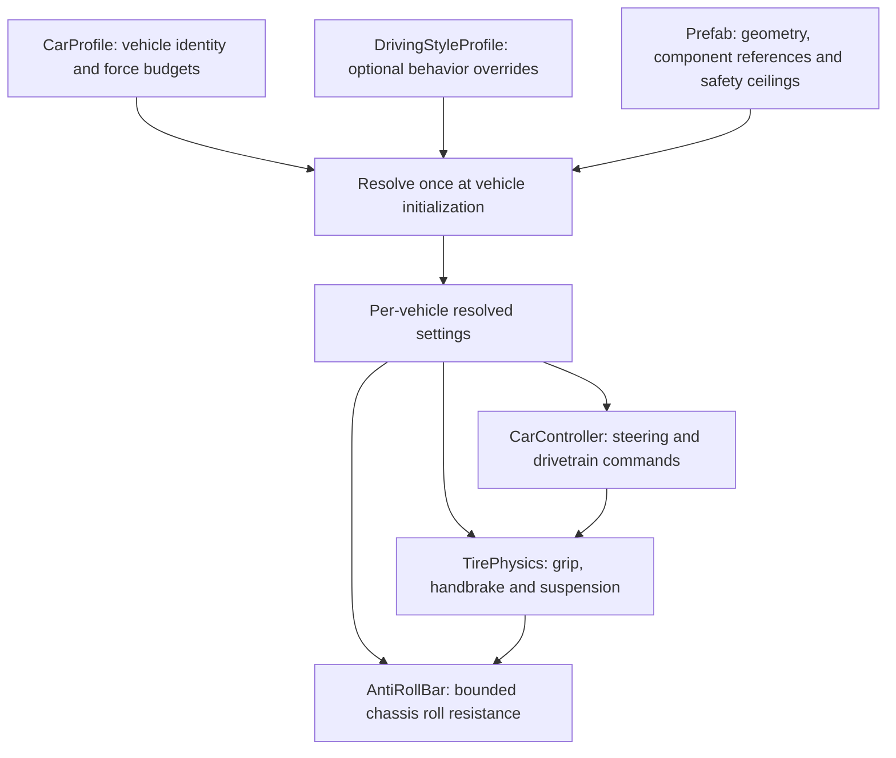

DriveFeel — Modular Vehicle Physics for Unity
Build distinct driving experiences with the same vehicle and the same underlying physics systems.

DriveFeel is a Unity vehicle-handling prototype and technical game-design portfolio project. It separates a vehicle's identity (CarProfile) from its optional driving behavior (DrivingStyleProfile). At initialization, the controller resolves those settings into per-vehicle runtime values used by the existing steering, tire, suspension and anti-roll systems.

Portfolio: assafarayhan.framer.website
Repository: RayhanMaiMai/Modular-Vehicle-Physics
Scope: Game-feel-focused custom vehicle physics, not a physically complete automotive simulator. The milestone acceptance described below is based on owner-performed manual Unity Play Mode checks; it does not imply automated test coverage.

What is implemented
- Vehicle identity and driving-style composition — one CarProfile plus an optional DrivingStyleProfile with five independently enabled sections.
- Steering — speed-dependent steering range, smoothing and Ackermann-style left/right steering geometry.
- Custom four-wheel tire system — spherecast-based grounding, lateral grip curves, per-wheel slip response and longitudinal force application; no WheelCollider dependency in the vehicle model.
- Suspension and chassis stability — independent spring/damper responses and bounded, grounded-wheel anti-roll forces applied to the main chassis Rigidbody.
- Drivetrain — whole-vehicle acceleration and service-braking budgets, FWD/RWD/AWD distribution, automatic/manual gear states and engine braking.
- Handbrake — rear-axle lateral-grip adjustment and per-rear-tire longitudinal drag cap.
- Predictable configuration — immutable per-instance steering/settings snapshots resolved on initialization, null-style parity, validation/fallback and optional one-shot diagnostics.
- Physics update ownership — input sampled outside physics; vehicle commands, tire contact and anti-roll processed in an ordered fixed-step pipeline.
Driving styles
Three design directions were manually tested on the same vehicle:
Style	Intended driving experience	Primary differences
Balanced / Cozy	Stable, accessible, predictable	Canonical vehicle steering, grip, suspension, handbrake and bounded anti-roll
Responsive / Arcade Racing	Direct, expressive, quick to turn	Faster steering response, distinct front/rear grip, handbrake-friendly rear rotation
Progressive / Simulation-Inspired	Measured, gradual and momentum-conscious	Smoother steering, different slip/grip response, more deliberate handbrake and chassis compliance

These are style configurations, not different vehicle physics engines or a claim of real-world dynamics accuracy. The exact asset values may evolve as tuning continues.
Open and drive the demo
1. Clone the repository and open the project in Unity 6000.3.13f1 using Unity Hub (version reported by the project's implementation audits; verify ProjectSettings/ProjectVersion.txt on checkout).
2. Allow the packages and scripts to import. The project uses the Unity Input System and URP.
3. Open Assets/Scenes/Develop_Test Drive Mechanic.unity.
4. Enter Play Mode, approach the vehicle and interact to take control.
5. In the vehicle's CarController, assign an optional DrivingStyleProfile or leave it unassigned for canonical baseline behavior. Exit and re-enter Play Mode after changing an assignment: styles resolve at initialization, not continuously.
Canonical prefab: Assets/Contents/Prefabs/Car Prefabs/DriveFeel_Car.prefab.
Controls
The project uses Unity Input Actions. The keyboard layout below reflects the P0-B intended mapping; confirm the currently saved bindings in Assets/InputSystem_Actions.inputactions before publishing, because the accepted conflict fixes were performed manually in the Editor and the final asset was not available for this documentation pass.
Action	Keyboard (intended mapping)	Notes
On-foot movement / vehicle steering	W / A / S / D or arrow keys	On foot: movement. In car: horizontal steering; vertical input for throttle/brake/reverse.
Enter / exit vehicle	E	Exit is subject to the vehicle's safe-speed condition.
Vehicle throttle / brake / reverse	W / S (or up/down)	Signed input; automatic transmission can select drive/reverse according to motion.
Handbrake	Space	Dedicated vehicle action; distinct from the on-foot Jump action even if they share a context-dependent key.
Manual shift up	R	Applies only when the gearbox is configured for manual shifting.
Manual shift down	Q	Applies only when the gearbox is configured for manual shifting.
Horn	H	Audio only.

Gamepad bindings and any owner-customized keyboard changes should be read from the Input Actions asset; do not infer or assume controller buttons from this table.
Create or customize a driving style
1. In Unity, choose Assets → Create → DriveFeel → Driving Style Profile.
2. Assign the asset to Optional Driving Style on the canonical vehicle controller.
3. Enable only the sections you want to override: Steering, Tire Response, Handbrake, Suspension, and Anti Roll.
4. Enter values for the enabled sections. Leave others disabled to preserve that vehicle's authored component values.
5. Enable Log Resolved Style On Awake during development to compare authored and effective settings without changing the serialized baseline.
6. Re-enter Play Mode to rebuild the runtime snapshot, then repeat the same driving test for a useful comparison.
The style cannot bypass a disabled anti-roll gate or increase either anti-roll force cap beyond the vehicle prefab's authored safety cap. Grip curves are copied into independent runtime configurations so shared style assets are not modified by the simulation.

For parameter meanings, tuning ranges, force distribution and the associated equations, see [Vehicle Tuning & Equations](docs/Vehicle-Tuning-and-Equations.md).
Architecture

Fixed-step order: CarController (-100) → TirePhysics (0) → AntiRollBar (+100).

Authored Inspector values are intentionally left untouched when a style is applied. The current driving behavior reads the resolved runtime values, not the visible baseline values. Shared profiles can therefore be reused by multiple vehicles without cross-instance mutation.
Verification status
The project owner manually accepted the foundation milestones for force-budget allocation, fixed-step physics timing, gearbox state reliability, chassis anti-roll safety and the steering-style pilot. A subsequent 15/15 manual CODEX-14/15 checklist passed, including null-style parity, braking, tire response, suspension, anti-roll, invalid-value fallback, shared-style isolation and regression checks.

These checks were done in the Unity project by the owner. They are not CI tests or formal performance benchmarks, and clean-clone reproduction should be verified as part of publication.
Boundaries and limitations
- Tire grip is an arcade-style velocity/curve response, not a real tire friction-circle or load-sensitive simulation.
- Gearbox RPM is a normalized gameplay approximation, not a mechanically simulated engine/clutch/differential.
- The CarProfile.topSpeed field is a power-curve reference speed, not a hard speed limiter by itself.
- ABS is time-based brake modulation, not wheel-slip-aware anti-lock braking.
- Driving-style switching is initialization-only; changing an asset during Play Mode does not rebuild an existing vehicle's snapshot.
- Anti-roll response is bounded by prefab-authored caps and initially requires both wheels on an axle to be grounded.
Project organization
Assets/
  Scenes/                            # Test-drive scene
  Scripts/Car Systems/               # Vehicle controller, profiles, tire and chassis physics
  Contents/Prefabs/Car Prefabs/      # Canonical DriveFeel_Car prefab
  Contents/Scriptable Objects/      # Vehicle profiles and driving styles
Packages/
ProjectSettings/
docs/
  Vehicle-Tuning-and-Equations.md    # Mathematical and designer tuning reference
Attribution, redistribution and licensing
Before making a public release, verify the licenses of all bundled models, sounds, textures, packages and other third-party assets. A repository-wide license should be added only after deciding the permissions intended for the original project code and checking redistribution rights for included content.

For project and portfolio information, visit assafarayhan.framer.website.
